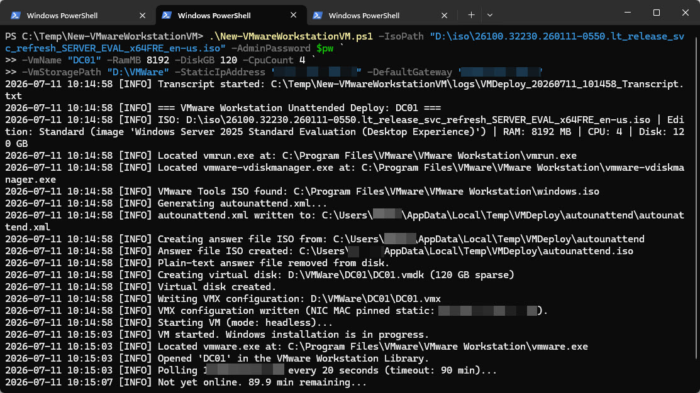
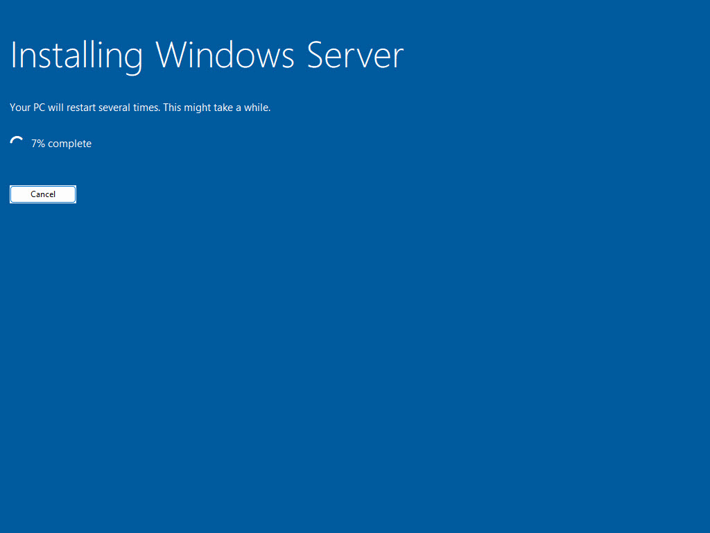

# New-VMwareWorkstationVM

[](LICENSE)
[](https://learn.microsoft.com/powershell/)
[](https://www.microsoft.com/windows)
[](https://www.vmware.com/products/desktop-hypervisor.html)

Unattended Windows Server 2025 deployment to VMware Workstation. One command. No ADK, Ansible, etc. No clicking through Setup.

If you have ever sat there pressing Next through Windows Server Setup on a VM you know you are going to rebuild three days from now, this is for you.

## What It Does

A single PowerShell 5.1 script that takes a Windows Server ISO and produces a running, network-reachable VM. Specifically:

1. Generates an `autounattend.xml` answer file for the windowsPE, specialize, and oobeSystem passes
2. Packages that XML into a bootable ISO using Windows' built-in IMAPI2, with no Windows ADK required
3. Creates a sparse VMDK via `vmware-vdiskmanager.exe`
4. Writes a VMX configured for BIOS firmware, MBR partitions, NVMe storage, and vmxnet3 networking
5. Starts the VM (headless by default, or with the Workstation console if you want to watch)
6. Opens the VM in the Workstation GUI library automatically
7. With a static IP, polls for the VM to come online, waits out a fixed settle delay to give the specialize pass time to finish, ejects the installation ISOs, power-cycles the VM to delete the CD/DVD drive entries from the VMX entirely, and confirms the VM is back up

That last step is not optional cleverness. VMware Workstation rewrites the VMX from its in-memory device list when a VM powers off, silently clobbering any edit made while it was running. The only way to persist a device-list change is to make it while the VM is fully off. So the script stops the VM softly, edits the VMX while nothing has it open, and starts it again. I'll admit I bled on this one just a bit.

## What's New in 1.2

**What you must do.**

- **Nothing, for most of you.** Your override file and your command lines carry over as they are. Check two things. Anything that passes an empty `-AdminPassword` now stops, as Bugs fixed below says. And build-lab 2.3's custom VMnets need this release, so upgrade the two together.

**Breaking and behavior changes.**

- **`-NetworkType` no longer tab-completes.** It takes a pattern now instead of a fixed list of three, so PowerShell has no list to offer when you press Tab. A value it refuses gets PowerShell's pattern message, which quotes the pattern instead of listing the three names.
- **The VMX gets the network name in lower case.** 1.1 wrote the value as you typed it, so `-NetworkType NAT` put `NAT` in the VMX. 1.2 writes `nat`, `bridged` or `hostonly` whatever case you type.
- **One or two new lines in the log.** Right after the `ISO:` line, the log names the network, such as `Network: nat` or `Network: VMnet2 (custom)`. Spell it `VMnet0`, `VMnet1` or `VMnet8` and a second line says which name it was taken as.
- **Population settings get sent to the right file.** `Population` and `DomainAdminCount` belong in new-AdDomain's override file, and `DeferPopulation` and `PopulationTimeoutMinutes` in build-lab's. Put one in this project's file and the stop names the file it belongs in, as it already did for those projects' other settings.

**New.**

- **Custom VMnets.** `-NetworkType` takes a VMnet by name, `VMnet0` to `VMnet99`, so a VM can sit on a host-only network of its own. The VMnet has to exist already. [Custom VMnets](#custom-vmnets) has the rest. `VMnet0`, `VMnet1` and `VMnet8` are taken as `bridged`, `hostonly` and `nat`, so the VMX gets the line those names have always had.
- **An example override file.** `examples\overrides.psd1` lists every setting the override file takes, each one commented out at its shipped value under a line that says what it changes. Copy it into `overrides\` and you start from a full list instead of a blank file. [Override File](#override-file) has a command that copies it without touching a file you already have.
- **License and source in every script's help.** Each script's help names its license, `SPDX-License-Identifier: MIT`, and links to this repository, so `Get-Help .\New-VMwareWorkstationVM.ps1 -Online` opens it. `Logging.ps1`, `OverrideFile.ps1` and `Sanitization.ps1` in `include\` are shared with the other lab projects, so they link to my GitHub profile instead.

**Bugs fixed.**

- An empty `-AdminPassword` was accepted. That is what pressing Enter at the prompt gives you, and the answer file would have set a blank Administrator password. The run now stops before the VM or any of its files is created. A password made of spaces still goes through. It's a weak password, not an empty one. Since 1.0.
- A square bracket in the temp folder's path, such as `-TempPath D:\Lab[2]\temp`, could leave the answer files that hold the Administrator password on disk while the log said they were gone. PowerShell read the brackets as a wildcard, so the delete matched nothing and raised no error. The log said the plain-text answer file was removed and, from 1.1, that the answer ISO was deleted. The WARN about a retained ISO never came. The same misreading refused an `-IsoPath` in a folder with brackets and missed an existing VMX in one. Each of these paths is now taken exactly as written. If you ever gave `-TempPath` or the override file's `TempPath` a bracket, look in that folder for `autounattend.xml` and `autounattend.iso` and delete them. The default, `%TEMP%\VMDeploy`, was never affected, because a Windows user name can't contain a bracket. Since 1.0.
- `Export-OverrideFile.ps1` wrote the comment above a migrated setting with the line number of the parameter's first attribute, not the line that holds its value. Since 1.1.
- `Export-OverrideFile.ps1` couldn't carry across an answer file value holding a character reference padded with leading zeros past seven decimal or six hex digits, such as `&#000000038;` for `&`. It listed the setting for you to set by hand instead. Since 1.1.

## What's New in 1.1

- **An override file for your settings.** Everything you'd otherwise change by editing the script now goes in `overrides\overrides.psd1`, which upgrades leave alone. That covers the parameter defaults, the install image name for each edition, the VMX `guestOS` value, and the answer file's input, system and user locales and organization. [OVERRIDE.md](OVERRIDE.md) lists every setting with its default and permitted values, and a value you pass on the command line still wins.
- **A script that moves your old edits across.** `Export-OverrideFile.ps1` reads an older copy of the script without running it, compares each setting with what that release shipped, and writes only the ones you changed into the override file. It never overwrites an override file you already have. [UPGRADE.md](UPGRADE.md) walks through it.
- **The logs land beside the script.** Started with `powershell.exe -File` from another folder, 1.0.x put its logs under that folder instead of the script's. A run without `-LogPath` now always logs to the `logs` folder next to the script.
- **Relative paths mean what they say.** `-LogPath`, `-TempPath` and `-VmStoragePath` become full paths before anything uses them, so a relative path resolves from your current location for the folder and for every file written into it, even after a `Set-Location`. A path on a drive that doesn't exist stops the run with one plain message, before the VM or any of its files is created.
- **Locale values in any letter case.** `en-gb` works as well as `en-GB` in the locale settings. Microsoft's answer file reference says the system and user locale values aren't case-sensitive.
- **A changed default gets named.** When a release changes a shipped default and your run leaves that setting alone, the log gets one INFO line with the old value, the new one and the setting that keeps the old one. 1.1 changes no default, so you won't see one yet.
- **Help for every parameter.** `Get-Help .\New-VMwareWorkstationVM.ps1 -Detailed` describes each one.

## Screenshots

**1. Launch and setup.** One command kicks it off. The script builds the answer file and its ISO, carves out the sparse disk, writes the VMX, starts the VM headless, drops it into the Workstation library, and settles in to poll for the static IP.



**2. Windows Server installing.** Setup runs itself. No prompts, nobody clicking Next, nothing to babysit.



**3. Deployment complete.** Here is the payoff. Once the VM answers a ping, the script waits out the settle delay, ejects the installation media, power-cycles to strip the CD/DVD drives from the VMX, and confirms the VM comes back online with nothing attached. This run took ten minutes start to finish.


## Requirements

- **VMware Workstation 17+** with `vmrun.exe` and `vmware-vdiskmanager.exe` in the default install path
- **PowerShell 5.1** (no PowerShell 7 requirement, no ADK dependency)
- **Windows Server 2025 ISO** (evaluation, volume license, or retail. See [Image Name Verification](image-name-verification.md) before switching media)
- Enough local disk and RAM to host the VM

The script locates `vmrun.exe` and `vmware-vdiskmanager.exe` automatically under `%ProgramFiles%\VMware\VMware Workstation` and `%ProgramFiles(x86)%\...`. If they are not where the script expects them, it will tell you clearly and stop.

## Tested On

- **VMware Workstation Pro 26.0.0.25388281 (version 26H1).** This should run on 17+. 26H1 is what I'm running so it is what I have to test against. The `vmrun` and `vmware-vdiskmanager` interfaces it depends on have been stable across major versions, so earlier or later builds are expected to work, but only 26H1 has been verified. Keep your software up to date. It's a good practice.
- **Windows Server 2025 evaluation media (`SERVER_EVAL_x64FRE`).** Full end-to-end deploys have been validated against evaluation media only. The retail and volume license paths (`-ProductKey` plus the image name settings) are wired up but have not yet been run on a live deploy. Run through [Image Name Verification](image-name-verification.md) before switching media.
- **Custom VMnets, on one host.** A live build on VMnet2 wrote `ethernet0.connectionType = "custom"` and `ethernet0.vnet = "VMnet2"`. Both lines were still there after the power cycle at the end of the deploy, and the VM answered on that network. A build on VMnet1, taken as `hostonly`, passed too. `nat`, `bridged` and `hostonly` write the same line they always have.

## Quick Start

Clone the repository:

```powershell
git clone https://github.com/0x44616e69656c/New-VMwareWorkstationVM.git
cd New-VMwareWorkstationVM
```

Downloaded the zip instead? Windows blocks files downloaded from the internet by default, and a `RemoteSigned` execution policy won't run a blocked script. Look the files over, then unblock them from inside the extracted folder:

```powershell
Get-ChildItem -Recurse -File | Unblock-File
```

Then run it:

```powershell
$pw = ConvertTo-SecureString 'P@ssw0rd1!' -AsPlainText -Force

.\New-VMwareWorkstationVM.ps1 `
    -IsoPath       "D:\ISOs\WS2025_eval.iso" `
    -AdminPassword $pw `
    -VmStoragePath "D:\VMs"
```

That creates a VM named `WS2025-Server` with 4 GB RAM, 2 vCPUs, 60 GB disk, and NAT networking on DHCP. Installation typically takes less than 15 minutes. Monitor it in VMware Workstation. When it is done, the VM is sitting at a desktop with VMware Tools installed. Without `-StaticIpAddress` the script can't tell when the VM is up, so it leaves the installation media attached and the answer ISO, which holds the Administrator password in plain text, in the temp folder. Once the install finishes, disconnect the VM's CD/DVD drives in Workstation, since VMware holds the ISO open while it's attached, and delete the file. [Things Worth Knowing Before You Deploy](#things-worth-knowing-before-you-deploy) has the details, and the static IP example below cleans up after itself.

## Full Example With Static IP

```powershell
$pw = ConvertTo-SecureString 'P@ssw0rd1!' -AsPlainText -Force

.\New-VMwareWorkstationVM.ps1 `
    -IsoPath               "D:\ISOs\WS2025_eval.iso" `
    -AdminPassword         $pw `
    -VmName                "LabServer01" `
    -VmStoragePath         "D:\VMs" `
    -ComputerName          "LABSERVER01" `
    -RamMB                 8192 `
    -CpuCount              4 `
    -DiskGB                120 `
    -Edition               Standard `
    -NetworkType           bridged `
    -StaticIpAddress       "192.168.1.50" `
    -DefaultGateway        "192.168.1.1" `
    -DnsServer             "192.168.1.1" `
    -PostSetupDelayMinutes 10
```

With `-StaticIpAddress` set, the script polls until the VM responds to ping, waits the settle delay for specialize to complete, ejects the ISOs, soft-stops the VM, removes the CD/DVD drive entries from the VMX, restarts the VM, and confirms it is back online. You walk away with a clean VM in the Workstation library.

## Custom VMnets

`-NetworkType VMnet2` puts the VM's adapter on VMnet2 instead of one of the three named networks. Any VMnet from `VMnet0` to `VMnet99` works, written without a leading zero, in any letter case. The script only picks the VMnet. It never creates or changes one and never touches the host's network settings, so set the VMnet up first in Workstation's Virtual Network Editor.

The online check pings the VM from the host. With `-StaticIpAddress` set, the host needs a virtual adapter on that VMnet with an address in the VM's subnet, or the ping never gets an answer. The script then waits out `-TimeoutMinutes`, logs a WARN and skips the media cleanup, which leaves the answer ISO with the Administrator password in the temp folder.

A host-only VMnet with no NAT has no way out to the internet, and that matters for evaluation media. Microsoft's Evaluation Center page for Windows Server 2025 says "Evaluation versions of Windows Server must be activated over the internet in the first 10 days to avoid automatic shutdown." So a VM on evaluation media on an isolated VMnet is a short-lived VM, unless you activate it some other way. A Windows 11 evaluation client you build by hand on the same network has its own activation rule, and I haven't checked how that one plays out offline.

build-lab's custom VMnets need this release or later. An older copy of this script refuses anything but the three names.

## Override File

Every setting you can change without editing a script, and how, is in [OVERRIDE.md](OVERRIDE.md). Your settings live in a file of their own that upgrades leave alone, so you never have to make the same edit to a new copy of the script. Edited an older copy of the script? [UPGRADE.md](UPGRADE.md) shows how to move those edits across.

To start a file of your own, copy `examples\overrides.psd1` into an `overrides` folder in the project folder. Every setting in it is commented out at its shipped value, so the copy changes nothing until you take the `#` off a line and change its value. Run this from the project folder. It makes the folder and copies the file, and it leaves an override file you already have alone:

```powershell
if (-not (Test-Path -Path .\overrides\overrides.psd1)) { New-Item -ItemType Directory -Path .\overrides -Force | Out-Null; Copy-Item -Path .\examples\overrides.psd1 -Destination .\overrides\ }
```

## Parameters

A parameter's default can also be changed in the override file. [OVERRIDE.md](OVERRIDE.md) lists which ones, and a value you pass on the command line always wins.

| Parameter | Default | Notes |
|---|---|---|
| `-IsoPath` | **Required** | Full path to the Windows Server 2025 ISO |
| `-AdminPassword` | **Required** | SecureString for the local Administrator account. An empty password stops the run before the VM or any of its files is created. |
| `-VmStoragePath` | **Required** | Parent directory where the VM folder will be created. A relative path resolves from the current location. |
| `-VmName` | `WS2025-Server` | VM folder name, VMX filename, VMDK name, and Workstation display name |
| `-ComputerName` | `WIN2025` | Windows hostname (NetBIOS, 1-15 chars, alphanumeric and hyphens) |
| `-RamMB` | `4096` | RAM in MB, from 512 to 65536 |
| `-CpuCount` | `2` | vCPUs, from 1 to 64 |
| `-DiskGB` | `60` | OS disk in GB, from 20 to 2048 (the MBR 2 TB cap) |
| `-Edition` | `Standard` | `Standard` or `Datacenter` |
| `-TimeZone` | `Pacific Standard Time` | Windows time zone ID for the guest (`tzutil /l` lists valid values) |
| `-ProductKey` | (none) | Optional product key. Omit for evaluation media. Supply for retail/VLSC media or the activation screen will stop the unattended install. |
| `-NetworkType` | `nat` | `nat`, `bridged`, `hostonly`, or a VMnet by name from `VMnet0` to `VMnet99`. See [Custom VMnets](#custom-vmnets). |
| `-StaticIpAddress` | (none) | Configures a static IP in the guest and enables online polling and media cleanup |
| `-SubnetMask` | `255.255.255.0` | Subnet mask for static IP |
| `-DefaultGateway` | (none) | Default gateway for static IP |
| `-DnsServer` | `8.8.8.8` | DNS server for static IP |
| `-ShowConsole` | switch | Show the Workstation console window instead of running headless |
| `-TimeoutMinutes` | `90` | The longest wait for the VM to come online after starting (range 1-1440) |
| `-PostSetupDelayMinutes` | `5` | Settle delay after first ping before ejecting media. A ping response only means TCP/IP is up, and specialize may still be running. Range 0-60. |
| `-ShutdownTimeoutMinutes` | `5` | The longest wait for the soft shutdown to complete before giving up on drive removal (range 1-30) |
| `-RestartTimeoutMinutes` | `10` | The longest wait for the VM to come back online after the post-removal restart (range 1-60) |
| `-LogPath` | `<script dir>\logs` | Directory for the CSV log and full transcript. Defaults to a `logs` folder next to the script (`$PSScriptRoot`), not the working directory. A relative path you pass resolves from the current location. |
| `-TempPath` | `%TEMP%\VMDeploy` | Scratch directory for the answer XML and bootable ISO. A relative path resolves from the current location. |

## Image Name Verification

**This is the step most likely to bite you silently if you skip it.**

The `/IMAGE/NAME` value in the answer file must match an image name in the target ISO's `install.wim` exactly, including whether "Evaluation" is in the name, the exact casing, and the brackets. If it does not match, Windows Setup does not show you a picker (the answer file suppresses that). It silently falls back to image index 1 (usually Server Core) and then fails late with "Setup has failed to validate the product key." That error has nothing to do with product keys. It is the signature of an image name mismatch.

The script is configured for the evaluation channel ISO out of the box. If you are using a different ISO, whether a different build, a different channel, volume license or retail, run through [image-name-verification.md](image-name-verification.md) before you deploy. It takes about two minutes.

The quick version:

```powershell
$isoPath = "D:\ISOs\WS2025_eval.iso"
$mount = Mount-DiskImage -ImagePath $isoPath -PassThru
$driveLetter = ($mount | Get-Volume).DriveLetter
Get-WindowsImage -ImagePath "${driveLetter}:\sources\install.wim" | Select-Object ImageIndex, ImageName | Format-Table -AutoSize
Dismount-DiskImage -ImagePath $isoPath
```

Copy-paste the exact `ImageName` strings for the Desktop Experience variants of Standard and Datacenter into the `ImageNameStandard` and `ImageNameDatacenter` settings of your override file. Do not retype them. [OVERRIDE.md](OVERRIDE.md) shows where the file goes, and the script itself stays as shipped.

## Logs

Every run produces two files in the log directory, or one if the transcript could not start, which the script warns you about and carries on:

- `VMDeploy_<timestamp>.csv` - structured event log with the columns `Timestamp,Level,Message,ErrorDetail`. Import it directly with `Import-Csv`.
- `VMDeploy_<timestamp>_Transcript.txt` - full PowerShell transcript of the run, including all host output, error records, and stack traces.

The transcript is there specifically for diagnosing problems after the fact. When something fails and the CSV does not tell you enough, the transcript will.

`Export-OverrideFile.ps1` writes `Export-OverrideFile_<timestamp>.csv` there too, one row per setting it read, with a product key shown as `<set>`.

If you create a bug report, please include these files.

## VMX Configuration

The VMX template is not arbitrary. Every choice here was reached by hitting a wall:

- `firmware = "bios"` and MBR partitions - stock Microsoft install ISOs include a "Press any key to boot from CD or DVD" prompt on EFI boot that a headless `vmrun start ... nogui` can never answer. BIOS boot (`boot\etfsboot.com`) has no such prompt.
- `pciBridge0` plus `pciBridge4` through `pciBridge7` (pcieRootPort, 8 functions each) - required for PCI device slot allocation on `virtualHW.version 19` regardless of whether `firmware` is `bios` or `efi`. Removing them produces "No PCIe slot available" on power-on.
- `nvme0` for the OS disk - `lsisas1068` (LSI SAS SCSI) cannot get a PCI slot under BIOS firmware on `virtualHW.version 19` on the test host, even with the pciBridge block present. NVMe is the inbox WS2025 disk driver and works cleanly.
- `vmxnet3` NIC with a static MAC in VMware's manual-assignment range (`00:50:56:00:00:00` to `00:50:56:3F:FF:FF`) - the answer file's `<Identifier>` for the TCPIP and DNS-Client components binds to that MAC, so the static IP configuration lands on the right adapter regardless of what Windows calls it.
- `ulm.disableMitigations = "TRUE"` - suppresses the Spectre/Meltdown performance mitigation popup on Hyper-V/VBS-enabled hosts (VMware KB 79832). Acceptable for short-lived lab VMs. This script is dangerous in multiple ways outside that scope and this is the least of those.
- `guestOS = "windows2022srvnext-64"` - the VMware Workstation 17.x identifier for Windows Server 2025. If your Workstation version warns about the guest OS, the `GuestOS` setting in the override file changes it.

## Things Worth Knowing Before You Deploy

**The answer ISO contains the Administrator password in plain text.** The script deletes it automatically after the VM comes online and the ISO lock is released. If you do not supply a static IP, or the online check times out, the file stays in the temp folder, `%TEMP%\VMDeploy` unless you set `-TempPath`. The script warns you with the exact path. Delete it manually.

**Static IP requires the inbox vmxnet3 driver in the Windows Server media.** If the driver is absent, the NIC is invisible during the specialize pass and the static config silently falls back to DHCP. If the static IP never shows up, check `C:\Windows\Temp\netsetup.log` on the deployed VM (the script writes it during specialize). That log shows you what the network stack actually looked like.

**The disk size cap is 2048 GB.** The MBR boot partition's LBA field is 32-bit. If you need a larger OS disk, you need UEFI/GPT, which means remastering the ISO with `efisys_noprompt.bin` to remove the "press any key" prompt. If you get froggy send me a link to your project and I'll add a link here in the README.

**VMware Tools are installed silently during specialize** if the bundled `windows.iso` is found alongside `vmrun.exe`. The specialize command searches drive letters D through H for `VMwareToolsUpgrader.exe` (a file unique to the Tools ISO) before running `setup.exe`. That avoids accidentally running Windows Setup's own `setup.exe`, which is also at the root of the install ISO.

## Known Limitations

These are documented, deliberate trade-offs for a lab deployment tool. Also known as why did he do that stupid thing?
These should be considered "won't fix" items. They were considered and this was the best solution for the scope of this project.

- **AutoLogon** writes the Administrator password to `HKLM\...\Winlogon\DefaultPassword` during setup. Windows does not reliably clear it after the single logon completes.
- **RDP is opened on all firewall profiles** (`<Profile>all</Profile>`). Narrow the rule after deployment if that concerns you.
- **No WinRE/recovery partition.** The MBR layout uses two partitions, 350 MB System Reserved (active) and the OS. Changing this without getting it exactly right disables recovery, so it was deliberately left out.
- **`virtualHW.version 19`** (Workstation 17+ floor). It works. If you need a hardware version higher than 19 for a specific feature, expose it as a `-VirtualHWVersion` parameter and update the VMX template accordingly. Alternatively, and likely easier, just update the hardware version in the VMware GUI post deployment, but really this should be fine as is for most uses.
- **CPU side-channel mitigations are disabled by default** (`ulm.disableMitigations = "TRUE"`) on every VM the script creates. It is a lab!
- **ICMP echo request is allowed from any source on all firewall profiles**, solely so the script can poll the VM by ping. This broadens discovery/probing exposure on bridged or public networks. Narrow or remove the rule after deployment if that matters to you.
- **VM online (ping reply) is treated as a stand-in for Setup completion, not proof of it.** `Wait-VirtualMachineOnline` only confirms the requested `-StaticIpAddress` answers ICMP. Another host already using that address, or this VM mid-specialize, can satisfy it before the script ejects installation media and power-cycles the VM. A guest-authenticated, per-run marker-token check was designed as the fix (`vmrun fileExistsInGuest`/`copyFileFromGuestToHost` against a marker written by a `SetupComplete.cmd` hook) but was considered and not built. For a test deploy I decided it wasn't worth the trouble or added complexity.
- **`-PostSetupDelayMinutes` is a fixed heuristic, not an observable completion signal.** Once the VM answers ping, the script waits a fixed number of minutes (default 5) before ejecting installation media, on the assumption that Setup's specialize pass and the silent VMware Tools install have finished by then. A slower host can still be mid-specialize when media is ejected, and a faster host waits longer than it needs to.
- **`-TempPath` and `-LogPath` get no restrictive ACL.** The script writes the plaintext answer XML/ISO into whatever directory permissions already apply there, so a shared or redirected path can expose the Administrator password before cleanup runs.
- **Temp filenames are fixed, not per-run.** `autounattend.xml`/`autounattend.iso` share the same name under `-TempPath` across runs, so concurrent or overlapping deployments can overwrite or reuse another run's credential-bearing answer media.
- **The Windows ISO and VMware Tools media are trusted with no integrity check.** The script does not verify a hash or signature before booting the ISO or running `setup.exe` from the Tools media, so a substituted file executes with setup privileges.
- **The image name is not validated by the script before VM artifacts are created.** The image name must match an image name in the target ISO's `install.wim` exactly. A mismatch is not caught here but later, in Setup, after the answer ISO, VMDK, VM directory, and VMX already exist, and it fails with a misleading "Setup has failed to validate the product key" error rather than a clear image-name error. `image-name-verification.md` documents the manual `Get-WindowsImage` pre-check to run before pointing the script at a new ISO. I considered adding a check to catch this early, but it would have required running as admin and I don't want that to be true. Just don't mess this up and we'll all be happy.
- **The quick-start examples use a well-known static password** (`P@ssw0rd1!`). Don't use sample passwords. If you are paranoid enough to care about this (you should be) you already know this.
- **A `vmrun start` that prints "Error" but exits 0 can fail an already-running deployment.** `vmrun` is not consistent about exit codes. It can print an error line to stdout and still exit 0, so the start step treats any "Error" in the output as a failure and retries. On the rare occasion the VM actually started on the first attempt but `vmrun` also printed a benign "Error" line, the retry runs `vmrun start` again against a now-running VM, which really does error. The retries then exhaust and the deployment is reported failed even though the VM is up. Trusting the exit code alone is worse (a real failed start that exits 0 would go undetected), so the output check stays. If a deploy reports a start failure, check VMware Workstation before re-running, since the VM may already be running.
- **Not production.** Please do not deploy production servers with this. There are dangerous security compromises in this deployment that are fine for a lab but stupid for production. But you wouldn't be running production workloads in VMware workstation anyway I hope.

## Troubleshooting

**"Setup has failed to validate the product key"** - This is almost certainly an image name mismatch, not a product key problem. See [Image Name Verification](image-name-verification.md).

**VM stuck cycling the EFI Boot Manager** - The VM was started with `firmware = "efi"`. Check whether the VMX that ran was actually the script's output or a manually edited copy. The script always writes `firmware = "bios"`.

**"No PCIe slot available for SCSI0"** - The pciBridge block is missing from the VMX. Run the script as written, and do not strip out the `pciBridge` lines.

**Static IP never appeared in the guest** - Check `C:\Windows\Temp\netsetup.log` for the actual network configuration at the time of specialize. The vmxnet3 inbox driver may not be present in your media.

**CD/DVD drives still listed in VM Settings after deployment** - This only happens if the soft shutdown timed out or failed (the script logs a WARN with the reason). The drives will be ejected but still defined. Remove them manually in VM Settings, or run the power cycle yourself. Stop the VM, edit the VMX to delete the `sata0:0`, `sata0:1`, and `sata0:2` stanzas while it is off, and start the VM.

**Answer ISO still on disk after the run** - Expected if you did not supply `-StaticIpAddress` or the online check timed out. The script warns you and tells you where it is. Delete it, since it contains the Administrator password in plain text.

**Random fail** - During testing I had one random fail I could not reproduce. I suspect it was some kind of timing issues. If you have an error that is not something covered in this file, maybe try deleting the VM and re-running the setup. Check all the known issues first before re-trying.

## Contact

- Mastodon: [@daniel@infosec.exchange](https://infosec.exchange/@daniel)
- Email: 0x44616e69656c {AT} [not-this]danielowen[.]com
- LinkedIn: https://www.linkedin.com/in/danielowen/
- Web: https://danielowen.com

## Contributing

Bug reports and pull requests are welcome. This project accepts code changes through the fork and pull request model. See [CONTRIBUTING.md](CONTRIBUTING.md) for how to file a bug and the pull request requirements.

## License

Released under the [MIT License](LICENSE). You are free to use, copy, modify, and distribute this script, including for commercial purposes, provided the copyright notice and license text are retained. The software is provided "as is", without warranty of any kind.
