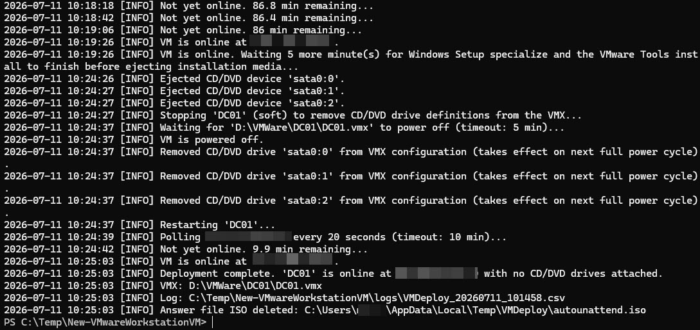

# New-VMwareWorkstationVM

[](LICENSE)
[](https://learn.microsoft.com/powershell/)
[](https://www.microsoft.com/windows)
[](https://www.vmware.com/products/desktop-hypervisor.html)

Unattended Windows Server 2025 deployment to VMware Workstation. One command. No ADK. No clicking through Setup.

If you have ever sat there pressing Next through Windows Server Setup on a VM you know you are going to rebuild three days from now, this is for you.

## What It Does

A single PowerShell 5.1 script that takes a Windows Server ISO and produces a running, network-reachable VM. Specifically:

1. Generates an `autounattend.xml` answer file for the windowsPE, specialize, and oobeSystem passes
2. Packages that XML into a bootable ISO using Windows' built-in IMAPI2 -- no Windows ADK required
3. Creates a sparse VMDK via `vmware-vdiskmanager.exe`
4. Writes a VMX configured for BIOS firmware, MBR partitions, NVMe storage, and vmxnet3 networking
5. Starts the VM (headless by default, or with the Workstation console if you want to watch)
6. Opens the VM in the Workstation GUI library automatically
7. With a static IP: polls for the VM to come online, waits for the specialize pass to finish, ejects the installation ISOs, power-cycles the VM to delete the CD/DVD drive entries from the VMX entirely, and confirms the VM is back up

That last step is not optional cleverness. VMware Workstation rewrites the VMX from its in-memory device list when a VM powers off, silently clobbering any edit made while it was running. The only way to persist a device-list change is to make it while the VM is fully off. So the script stops the VM softly, edits the VMX while nothing has it open, and starts it again. I'll admit I bled on this one just a bit. 

## Screenshots

**1. Launch and setup.** One command kicks it off. The script builds the answer file and its ISO, carves out the sparse disk, writes the VMX, starts the VM headless, drops it into the Workstation library, and settles in to poll for the static IP.


**2. Windows Server installing.** Setup runs itself. No prompts, nobody clicking Next, nothing to babysit.


**3. Deployment complete.** Here is the payoff. Once the VM answers a ping, the script waits out the specialize pass, ejects the installation media, power-cycles to strip the CD/DVD drives from the VMX, and confirms the VM comes back online with nothing attached.



## Requirements

- **VMware Workstation 17+** with `vmrun.exe` and `vmware-vdiskmanager.exe` in the default install path
- **PowerShell 5.1** (no PowerShell 7 requirement, no ADK dependency)
- **Windows Server 2025 ISO** (evaluation, volume license, or retail -- see [Image Name Verification](image-name-verification.md) before switching media)
- Enough local disk and RAM to host the VM

The script locates `vmrun.exe` and `vmware-vdiskmanager.exe` automatically under `%ProgramFiles%\VMware\VMware Workstation` and `%ProgramFiles(x86)%\...`. If they are not where the script expects them, it will tell you clearly and stop.

## Tested On

- **VMware Workstation Pro 26.0.0.25388281 (version 26H1).** This should run on 17+. 26H1 is what I'm running so it is what I have to test against. The `vmrun` and `vmware-vdiskmanager` interfaces it depends on have been stable across major versions, so earlier or later builds are expected to work, but only 26H1 has been verified. Keep your software up to date. It's a good practice. 
- **Windows Server 2025 evaluation media (`SERVER_EVAL_x64FRE`).** Full end-to-end deploys have been validated against evaluation media only. The retail and volume license paths (`-ProductKey` plus the `$imageName` switch) are wired up but have not yet been run on a live deploy. Run through [Image Name Verification](image-name-verification.md) before switching media.

## Quick Start

Clone the repository:

```powershell
git clone https://github.com/0x44616e69656c/New-VMwareWorkstationVM.git
cd New-VMwareWorkstationVM
```

Then run it:

```powershell
$pw = ConvertTo-SecureString 'P@ssw0rd1!' -AsPlainText -Force

.\New-VMwareWorkstationVM.ps1 `
    -IsoPath       "D:\ISOs\WS2025_eval.iso" `
    -AdminPassword $pw `
    -VmStoragePath "D:\VMs"
```

That creates a VM named `WS2025-Server` with 4 GB RAM, 2 vCPUs, 60 GB disk, and NAT networking on DHCP. Installation takes 20 to 45 minutes depending on your hardware. Monitor it in VMware Workstation. When it is done, the VM is sitting at a desktop with VMware Tools installed.

## Full Example With Static IP

```powershell
$pw = ConvertTo-SecureString 'P@ssw0rd1!' -AsPlainText -Force

.\New-VMwareWorkstationVM.ps1 `
    -IsoPath               "D:\ISOs\WS2025_eval.iso" `
    -AdminPassword         $pw `
    -VmName                "LabServer01" `
    -VmStoragePath         "D:\VMs" `
    -ComputerName          "LABSERVER01" `
    -RamMB                 8192 `
    -CpuCount              4 `
    -DiskGB                120 `
    -Edition               Standard `
    -NetworkType           bridged `
    -StaticIpAddress       "192.168.1.50" `
    -DefaultGateway        "192.168.1.1" `
    -DnsServer             "192.168.1.1" `
    -PostSetupDelayMinutes 10
```

With `-StaticIpAddress` set, the script polls until the VM responds to ping, waits the settle delay for specialize to complete, ejects the ISOs, soft-stops the VM, removes the CD/DVD drive entries from the VMX, restarts the VM, and confirms it is back online. You walk away with a clean VM in the Workstation library.

## Parameters

| Parameter | Default | Notes |
|---|---|---|
| `-IsoPath` | **Required** | Full path to the Windows Server 2025 ISO |
| `-AdminPassword` | **Required** | SecureString for the local Administrator account |
| `-VmStoragePath` | **Required** | Parent directory where the VM folder will be created |
| `-VmName` | `WS2025-Server` | VM folder name, VMX filename, VMDK name, and Workstation display name |
| `-ComputerName` | `WIN2025` | Windows hostname (NetBIOS, 1-15 chars, alphanumeric and hyphens) |
| `-RamMB` | `4096` | RAM in MB; range 512-65536 |
| `-CpuCount` | `2` | vCPUs; range 1-64 |
| `-DiskGB` | `60` | OS disk in GB; range 20-2048 (MBR 2 TB cap) |
| `-Edition` | `Standard` | `Standard` or `Datacenter` |
| `-TimeZone` | `Pacific Standard Time` | Windows time zone ID for the guest (`tzutil /l` lists valid values) |
| `-ProductKey` | (none) | Optional product key. Omit for evaluation media. Supply for retail/VLSC media or the activation screen will stop the unattended install. |
| `-NetworkType` | `nat` | `nat`, `bridged`, or `hostonly` |
| `-StaticIpAddress` | (none) | Configures a static IP in the guest and enables online polling and media cleanup |
| `-SubnetMask` | `255.255.255.0` | Subnet mask for static IP |
| `-DefaultGateway` | (none) | Default gateway for static IP |
| `-DnsServer` | `8.8.8.8` | DNS server for static IP |
| `-ShowConsole` | switch | Show the Workstation console window instead of running headless |
| `-TimeoutMinutes` | `90` | How long to wait for the VM to come online after starting (range 1-1440) |
| `-PostSetupDelayMinutes` | `5` | Settle delay after first ping before ejecting media. A ping response only means TCP/IP is up -- specialize may still be running. Range 0-60. |
| `-ShutdownTimeoutMinutes` | `5` | How long to wait for the soft shutdown to complete before giving up on drive removal (range 1-30) |
| `-RestartTimeoutMinutes` | `10` | How long to wait for the VM to come back online after the post-removal restart (range 1-60) |
| `-LogPath` | `<script dir>\logs` | Directory for the CSV log and full transcript. Defaults to a `logs` folder next to the script (`$PSScriptRoot`), not the working directory. A relative path you pass explicitly still resolves from the working directory. |
| `-TempPath` | `%TEMP%\VMDeploy` | Scratch directory for the answer XML and bootable ISO |

## Image Name Verification

**This is the step most likely to bite you silently if you skip it.**

The `/IMAGE/NAME` value in the answer file must match an image name in the target ISO's `install.wim` exactly -- including whether "Evaluation" is in the name, the exact casing, and the brackets. If it does not match, Windows Setup does not show you a picker (the answer file suppresses that). It silently falls back to image index 1 (usually Server Core) and then fails late with "Setup has failed to validate the product key." That error has nothing to do with product keys. It is the signature of an image name mismatch.

The script is configured for the evaluation channel ISO out of the box. If you are using a different ISO -- different build, different channel, volume license, or retail -- run through `image-name-verification.md` before you deploy. It takes about two minutes.

The quick version:

```powershell
$isoPath = "D:\ISOs\WS2025_eval.iso"
$mount = Mount-DiskImage -ImagePath $isoPath -PassThru
$driveLetter = ($mount | Get-Volume).DriveLetter
Get-WindowsImage -ImagePath "${driveLetter}:\sources\install.wim" | Select-Object ImageIndex, ImageName | Format-Table -AutoSize
Dismount-DiskImage -ImagePath $isoPath
```

Copy-paste the exact `ImageName` strings for the Desktop Experience variants of Standard and Datacenter into the `$imageName` switch in the script. Do not retype them.

## Logs

Every run produces two files in the log directory:

- `VMDeploy_<timestamp>.csv` -- structured event log, columns: `Timestamp,Level,Message,ErrorDetail`. Import directly with `Import-Csv`.
- `VMDeploy_<timestamp>_Transcript.txt` -- full PowerShell transcript of the run, including all host output, error records, and stack traces.

The transcript is there specifically for diagnosing problems after the fact. When something fails and the CSV does not tell you enough, the transcript will.

If you create a bug report, please include these files.

## VMX Configuration

The VMX template is not arbitrary. Every choice here was reached by hitting a wall:

- `firmware = "bios"` and MBR partitions -- stock Microsoft install ISOs include a "Press any key to boot from CD or DVD" prompt on EFI boot that a headless `vmrun start ... nogui` can never answer. BIOS boot (`boot\etfsboot.com`) has no such prompt.
- `pciBridge0` plus `pciBridge4` through `pciBridge7` (pcieRootPort, 8 functions each) -- required for PCI device slot allocation on `virtualHW.version 19` regardless of whether `firmware` is `bios` or `efi`. Removing them produces "No PCIe slot available" on power-on.
- `nvme0` for the OS disk -- `lsisas1068` (LSI SAS SCSI) cannot get a PCI slot under BIOS firmware on `virtualHW.version 19` on the test host, even with the pciBridge block present. NVMe is the inbox WS2025 disk driver and works cleanly.
- `vmxnet3` NIC with a static MAC in VMware's manual-assignment range (`00:50:56:00:00:00` to `00:50:56:3F:FF:FF`) -- the answer file's `<Identifier>` for the TCPIP and DNS-Client components binds to that MAC, so the static IP configuration lands on the right adapter regardless of what Windows calls it.
- `ulm.disableMitigations = "TRUE"` -- suppresses the Spectre/Meltdown performance mitigation popup on Hyper-V/VBS-enabled hosts (VMware KB 79832). Acceptable for short-lived lab VMs. This script is dangerous in multiple ways outside that scope and this is the least of those. 
- `guestOS = "windows2022srvnext-64"` -- the VMware Workstation 17.x identifier for Windows Server 2025.

## Things Worth Knowing Before You Deploy

**The answer ISO contains the Administrator password in plain text.** The script deletes it automatically after the VM comes online and the ISO lock is released. If you do not supply a static IP, or the online check times out, the file stays in `%TEMP%\VMDeploy`. The script warns you with the exact path. Delete it manually.

**Static IP requires the inbox vmxnet3 driver in the Windows Server media.** If the driver is absent, the NIC is invisible during the specialize pass and the static config silently falls back to DHCP. If the static IP never shows up, check `C:\Windows\Temp\netsetup.log` on the deployed VM (the script writes it during specialize) -- that log will show you what the network stack actually looked like.

**The disk size cap is 2048 GB.** The MBR boot partition's LBA field is 32-bit. If you need a larger OS disk, you need UEFI/GPT, which means remastering the ISO with `efisys_noprompt.bin` to remove the "press any key" prompt. If you get froggy send me a link to your project and I'll add a link here in the README.

**VMware Tools are installed silently during specialize** if the bundled `windows.iso` is found alongside `vmrun.exe`. The specialize command searches drive letters D through H for `VMwareToolsUpgrader.exe` (a file unique to the Tools ISO) before running `setup.exe` -- this avoids accidentally running Windows Setup's own `setup.exe`, which is also at the root of the install ISO.

## Known Limitations

These are documented, deliberate trade-offs for a lab deployment tool. Also known as why did he do that stupid thing?
These should be considered "won't fix" items. They were considered and this was the best solution for the scope of this project. 

- **AutoLogon** writes the Administrator password to `HKLM\...\Winlogon\DefaultPassword` during setup. Windows does not reliably clear it after the single logon completes.
- **RDP is opened on all firewall profiles** (`<Profile>all</Profile>`). Narrow the rule after deployment if that concerns you.
- **No WinRE/recovery partition.** The MBR layout uses two partitions: 350 MB System Reserved (active) and the OS. Changing this without getting it exactly right disables recovery; it was deliberately left out.
- **`virtualHW.version 19`** (Workstation 17+ floor). It works. If you need a hardware version higher than 19 for a specific feature, expose it as a `-VirtualHWVersion` parameter and update the VMX template accordingly. Alternatively, and likely easier, just update the hardware version in the VMware GUI post deployment, but really this should be fine as is for most uses. 
- **CPU side-channel mitigations are disabled by default** (`ulm.disableMitigations = "TRUE"`) on every VM the script creates. It is a lab!
- **ICMP echo request is allowed from any source on all firewall profiles**, solely so the script can poll the VM by ping. This broadens discovery/probing exposure on bridged or public networks; narrow or remove the rule after deployment if that matters to you.
- **VM online (ping reply) is treated as a stand-in for Setup completion, not proof of it.** `Wait-VirtualMachineOnline` only confirms the requested `-StaticIpAddress` answers ICMP; another host already using that address, or this VM mid-specialize, can satisfy it before the script ejects installation media and power-cycles the VM. A guest-authenticated, per-run marker-token check was designed as the fix (`vmrun fileExistsInGuest`/`copyFileFromGuestToHost` against a marker written by a `SetupComplete.cmd` hook) but was considered and not built. For a test deploy I decided it wasn't worth the trouble or added complexity. 
- **`-PostSetupDelayMinutes` is a fixed heuristic, not an observable completion signal.** Once the VM answers ping, the script waits a fixed number of minutes (default 5) before ejecting installation media, on the assumption that Setup's specialize pass and the silent VMware Tools install have finished by then. A slower host can still be mid-specialize when media is ejected; a faster host waits longer than it needs to.
- **`-TempPath` and `-LogPath` get no restrictive ACL.** The script writes the plaintext answer XML/ISO into whatever directory permissions already apply there, so a shared or redirected path can expose the Administrator password before cleanup runs.
- **Temp filenames are fixed, not per-run.** `autounattend.xml`/`autounattend.iso` share the same name under `-TempPath` across runs, so concurrent or overlapping deployments can overwrite or reuse another run's credential-bearing answer media.
- **The Windows ISO and VMware Tools media are trusted with no integrity check.** The script does not verify a hash or signature before booting the ISO or running `setup.exe` from the Tools media; a substituted file executes with setup privileges.
- **The image name is not validated by the script before VM artifacts are created.** `$imageName` must match an image name in the target ISO's `install.wim` exactly; a mismatch is not caught here but later, in Setup, after the answer ISO, VMDK, VM directory, and VMX already exist -- and it fails with a misleading "Setup has failed to validate the product key" error rather than a clear image-name error. `image-name-verification.md` documents the manual `Get-WindowsImage` pre-check to run before pointing the script at a new ISO. I considered adding a check to catch this early, but it would have required running as admin and I don't want that to be true. Just don't mess this up and we'll all be happy. 
- **The quick-start examples use a well-known static password** (`P@ssw0rd1!`). Don't use sample passwords. If you are paranoid enough to care about this (you should be) you already know this. 
- **A `vmrun start` that prints "Error" but exits 0 can fail an already-running deployment.** `vmrun` is not consistent about exit codes -- it can print an error line to stdout and still exit 0 -- so the start step treats any "Error" in the output as a failure and retries. On the rare occasion the VM actually started on the first attempt but `vmrun` also printed a benign "Error" line, the retry runs `vmrun start` again against a now-running VM, which genuinely errors; the retries then exhaust and the deployment is reported failed even though the VM is up. Trusting the exit code alone is worse (a real failed start that exits 0 would go undetected), so the output check stays. If a deploy reports a start failure, check VMware Workstation before re-running -- the VM may already be running.
- **Not production** Please do not deploy production servers with this. There are dangerous security compromises in this deployment that are fine for a lab but stupid for production. But you wouldn't be running production workloads in VMware workstation anyway I hope. 

## Troubleshooting

**"Setup has failed to validate the product key"** -- This is almost certainly an image name mismatch, not a product key problem. See [Image Name Verification](image-name-verification.md).

**VM stuck cycling the EFI Boot Manager** -- The VM was started with `firmware = "efi"`. Check whether the VMX that ran was actually the script's output or a manually edited copy. The script always writes `firmware = "bios"`.

**"No PCIe slot available for SCSI0"** -- The pciBridge block is missing from the VMX. Run with the script as written; do not strip out `pciBridge` lines.

**Static IP never appeared in the guest** -- Check `C:\Windows\Temp\netsetup.log` for the actual network configuration at the time of specialize. The vmxnet3 inbox driver may not be present in your media.

**CD/DVD drives still listed in VM Settings after deployment** -- This only happens if the soft shutdown timed out or failed (the script logs a WARN with the reason). The drives will be ejected but still defined. Remove them manually in VM Settings, or re-run the power cycle: stop the VM, edit the VMX to delete the `sata0:0`, `sata0:1`, and `sata0:2` stanzas while it is off, start the VM.

**Answer ISO still on disk after the run** -- Expected if you did not supply `-StaticIpAddress` or the online check timed out. The script warns you and tells you where it is. Delete it; it contains the Administrator password in plain text.

**Random fail** -- During testing I had one random fail I could not reproduce. I suspect it was some kind of timing issues. If you have an error that is not something covered in this file, maybe try deleting the VM and re-running the setup. Check all the known issues first before re-trying. 

## Contact

- Mastodon: [@daniel@infosec.exchange](https://infosec.exchange/@daniel)
- Email: 0x44616e69656c {AT} [not-this]danielowen[.]com

## Contributing

Bug reports and pull requests are welcome. This project accepts code changes through the fork and pull request model. See [CONTRIBUTING.md](CONTRIBUTING.md) for how to file a bug and the pull request requirements.

## License

Released under the [MIT License](LICENSE). You are free to use, copy, modify, and distribute this script, including for commercial purposes, provided the copyright notice and license text are retained. The software is provided "as is", without warranty of any kind.
